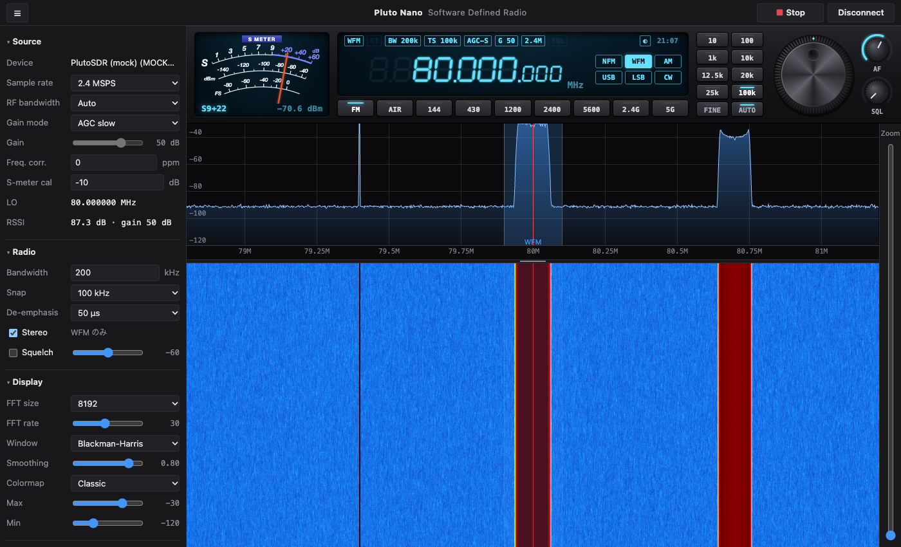

# Pluto SDR Nano

Pluto SDR Nano（ADALM-Pluto 互換の小型 SDR）用の、ブラウザで動く SDR 受信機。RTL-SDR（RTL-SDR Blog V3 など）でも受信できる。WebUSB でデバイスと直接通信するので、サーバーもドライバのインストールも要らない。画面は SDR++ を参考にし、操作部は ICOM の無線機風にしている。

**アプリ: https://pokibon3.github.io/PlutoNano/**



## 使い方

1. Pluto SDR Nano か RTL-SDR を USB で接続する（`iio_info`、SDR#、`rtl_tcp` など他のアプリが掴んでいないこと）
2. Chrome / Edge で https://pokibon3.github.io/PlutoNano/ を開く（ローカルの `dist/PlutoNano.html` でもよい）
3. **Connect** → 一覧からデバイスを選ぶ。接続すると自動で受信を始める
4. 最初の 1 回だけ、画面をクリックすると音が出る（ブラウザの自動再生制限のため）

2 回目以降は、ページを開くと許可済みのデバイスに自動で接続する（両方許可していれば前回使った方）。

### アプリとしてインストール（PWA）

上の URL を Chrome で開き、タイトルバーの **Install**、またはアドレスバー右端のインストールアイコンを押す。出ないときは Chrome の **︙** → **キャスト、保存、共有** → **ページをアプリとしてインストール**。

- 独立したウィンドウで開き、Dock / スタートメニューから起動できる
- 一度開けばオフラインでも起動する
- 新しい版が公開されると、起動時に自動で再読み込みして更新される。開いたままでも 30 分ごとと、ウィンドウが前面に戻ったときに確認し、見つかるとタイトルバーに **Update** が出る（押すと更新。受信・送信中に勝手に再読み込みはしない）
- 公開直後は配信側のキャッシュで約 10 分間は古い版が届くことがある
- アンインストールはアプリのウィンドウ右上の **︙** から

### 動作環境

WebUSB が必要なので、Chromium 系ブラウザ（Chrome / Edge）でのみ動く。

| 環境 | 状況 |
|---|---|
| macOS + Chrome / Edge | 動作確認済み |
| Windows + Chrome / Edge | 未確認。Pluto SDR Nano の IIO インターフェースに WinUSB ドライバが割り当たっている必要がある |
| Linux + Chrome / Edge | 未確認。一般ユーザーで USB にアクセスできるよう udev ルールが必要 |
| ChromeOS | 未確認（WebUSB・PWA とも対応している） |
| Android + Chrome | 未確認。USB OTG 接続で WebUSB が使える可能性がある |
| iPhone / iPad、Safari、Firefox | 動かない（WebUSB 非対応） |

## 画面と操作

### フロントパネル

| 部品 | 操作 |
|---|---|
| S メーター | IC-7300 風のアナログメーター（S / dBm / dBFS の 3 目盛り）。クリックでバー表示に切り替え |
| 周波数表示 | 桁をホイール / クリック（上半分で＋、下半分で−）で変更、ダブルクリックで直接入力（`82.5`, `433.92M`, `1.2G`） |
| 音声スコープ | 周波数表示の左。復調後の音声のスペクトラムに、フィルタの通過帯域を網掛けで重ねる |
| 情報行 | モード（クリックで切り替え）、ST（ステレオ受信中）、フィルタ（FIL1〜3 と帯域幅）、ステップ、AGC、ゲイン、サンプルレート、SQL、TX（送信中）、◐（配色をシアン / アンバーに切り替え）、時計 |
| モードキー | 周波数表示の下。NFM / WFM / AM / USB / LSB / CW |
| バンドキー | ダイヤルの左。FM / AIR / 50 / 144 / 430 / 1200 / 2400 / 5600（デバイスの受信範囲外のキーは無効。Pluto SDR Nano では 50、RTL-SDR では 2400 / 5600） |
| メインダイヤル | ドラッグで回す、またはホイール。1 回転 50 ステップ、時計回りで周波数が上がる。勢いよく回すと惰性で回り続ける |
| ダイヤル周りのキー | FINE / FAST で同調ステップ（10 Hz〜100 kHz）を 1 段ずつ小さく / 大きく、AUTO は速く回したときステップを 10 倍、FIL でフィルタを FIL1 → FIL2 → FIL3 と切り替え |
| フィルタ | モードごとに 3 つ。SSB 3.0k / 2.4k / 1.8k（100 Hz ローカット）、CW 1.2k / 500 / 250、AM 9k / 6k / 3k、NFM 15k / 10k / 7k、WFM 200k / 150k / 100k。帯域幅を変えると選択中の FIL に記憶する |
| AF / SQL つまみ | 上下ドラッグかホイールで音量 / スケルチ。SQL は左いっぱいで OFF |

### スペクトラム / ウォーターフォール

| 操作 | 動作 |
|---|---|
| クリック | その周波数に同調 |
| ドラッグ | 表示範囲を横スクロール（カーソル位置の周波数は固定） |
| 帯域の端をドラッグ | 帯域幅を変更（選択中の FIL に記憶） |
| ホイール（Shift で ×10）、← → キー | ステップ単位で同調 |
| Ctrl + ホイール、右端のスライダー | ズーム |
| 境界をドラッグ（ダブルクリックで初期値） | スペクトラムとウォーターフォールの高さを変更 |
| Space | 送信（押している間）。CW では電鍵 |
| Enter | 受信開始 / 停止 |

### 機能

- 復調: WFM（ステレオ対応、パイロット検出で ST 点灯）/ NFM / AM / USB / LSB / CW（キャリアを 600 Hz の音で再生、帯域 100 Hz〜3 kHz）。スケルチ、デエンファシス 50 / 75 µs
- バンドキー:
  - 144 / 430 / 1200 / 2400 / 5600 は日本のアマチュアバンドで、NFM・20 kHz ステップ
  - バンドごとに最後の周波数とモードを記憶する
- S メーター:
  - dBm は「dBFS − RX ゲイン + 補正値」で換算する。S9 = −93 dBm（VHF/UHF の慣例）、S 1 つ = 6 dB
  - 正確な値が必要なら、既知のレベルの信号を入れてサイドバーの **S-meter cal** で合わせる
- 周波数補正: サイドバーの **Freq. corr.**（ppm）で基準クロックの誤差を補正する。ずれ(Hz) ÷ 周波数(MHz) = ppm
- Wideband scan: 20 MSPS・16 MHz ステップで指定範囲を掃引する（約 7 ms/ステップ）。結果をクリックすると、その周波数で受信を始める
- 受信範囲は 70 MHz〜6 GHz（AD9364 の仕様。70 MHz 未満を受けるにはアップコンバーターが必要）
- サンプルレート: 2.4〜7.68 MSPS。2.083 MSPS 未満は Pluto SDR Nano に FIR フィルタの読み込みが必要なので選べない（受け付けられないレートを書き込むと、次のレート変更で Pluto SDR Nano が固まる）。USB 2.0 の実効上限が約 8 MSPS なので、連続受信は 6 MSPS 以下を推奨。7.68 MSPS では音が途切れることがある

### RTL-SDR

RTL2832U + R820T / R820T2 の RTL-SDR（RTL-SDR Blog V3 など）で受信できる。送信はできない。R828D の RTL-SDR Blog V4 や E4000 などほかのチューナーは未対応（接続時にそう表示する）。

- 受信範囲: 24〜1766 MHz（R820T2）。24 MHz 未満は自動でダイレクトサンプリング（Q ブランチ、V3 の HF 入力）に切り替え、0.5〜24 MHz を受信する
  - ダイレクトサンプリングは 28.8 MSPS の ADC で直接受けるので、14.4 MHz を境に折り返した信号（f と 28.8 MHz − f）が重なる。14.4 MHz より上はスペクトルの向きを直して表示する
  - 切り替えにはチューナーの初期化で約 0.5 秒かかる。RSSI 欄に「direct sampling」と出る
- サンプルレート: 1.024〜3.2 MSPS。2.4 MSPS 以下を推奨（それより上は USB の転送が間に合わず途切れることがある）
- ゲイン: 0〜49.6 dB（R820T の LNA + ミキサー、29 段）。AGC はアプリ側で行い、クリップしないよう手動ゲインを上げ下げする（R820T 内蔵の AGC は強い局で ADC が飽和するので使わない）。ダイレクトサンプリングではチューナーを通らないのでゲインは効かず、AGC は RTL2832U のデジタル AGC になる
- RF bandwidth: チューナーの IF フィルタ（Auto はサンプルレートに合わせる）
- **Bias-T**: アンテナ端子に 4.5 V を出す（V3 の GPIO 0）。接続のたびに OFF に戻る
- Freq. corr.（ppm）はチューナーとサンプルレートの両方を補正する。S メーターの補正値（S-meter cal）は Pluto SDR Nano とは別に保存され、初期値 −17 dB は最大ゲインでの RTL-SDR 自身の雑音（約 −169 dBm/Hz）から決めた目安。ダイレクトサンプリング（HF）を AGC で受信中はレベルが分からないので dBm を表示しない（Manual なら表示）
- バンドキーは 50 MHz が使え、2400 / 5600 は無効。Wideband scan は 2.4 MSPS・1.92 MHz ステップ
- Windows では Zadig で RTL-SDR（Bulk-In, Interface 0）に WinUSB ドライバを入れる。Linux では `dvb_usb_rtl28xxu` をブラックリストに入れ、udev ルールでアクセスを許可する。macOS はそのまま使える

### CW / FT8 / FT4（受信・送信）

サイドバーの **CW / FT8 / FT4** でモードを選ぶと、ウォーターフォールの下に送受信のパネルが開く。ウォーターフォールとの境目をドラッグして比率を変えられる（ダブルクリックで初期値）。パネルは [FTX-1 Controller](https://github.com/pokibon3/FTX1Controller) と同じ作りで、デコーダも同じもの（WebAssembly を AudioWorklet / Worker で実行）。受信は音量（AF）に関係なく、音量調整の前の音声を解読する。

- CW 受信: [CW Decoder 4](https://github.com/pokibon3/cw_decoder4) の WebAssembly 版（ESP32 版と同じ DSP / デコーダ、GPL）。表示も CW Decoder 4 の Web 版と同じで、状態の行（WPM・トーン・ピーク周波数・入力レベル）、解読文（最新の文字を強調）、FFT スペクトラム、オシロスコープ（KEY / ENV / RAW、時間軸の倍率）がある。CW / USB / LSB で受信する（FM / AM モードで選ぶと CW に切り替える）
  - `US` / `JP` で欧文・和文、トーンボタンで AUTO（500〜1000 Hz 自動同調）と手動 600〜1000 Hz を切り替える。FFT のクリックでもトーンを選べる
  - `NR` でノイズ低減（CW Decoder 4 v3.4 の SETUP の NR と同じ、適応型ラインエンハンサ ALE）。既定 ON（緑）。弱い信号の感度を上げ、ノイズの偽文字を減らす
  - FFT のダブルクリック、オシロスコープのクリックでそのグラフを全幅表示。**コピー** で解読文をクリップボードへ
  - 入力レベルはサイドバーの **CW input**
  - 受信機の AGC 後の音声を −20 dB 下げてデコーダに入れる（CW input の 0 dB がこの位置）。NR ON で受信フィルタが 500 Hz 以上のときは、CW Decoder 4 の Web 版と同じ入力 BPF（Q=3、トーン追従）を入れる。それより狭いフィルタや NR OFF では、BPF がノイズをトーンに見せるので入れない（評価は `tools/cw-eval.mjs`）
- CW 送信: 入力欄に文を入れて **SEND** か Enter（Shift+Enter は改行）。1 文字ずつ送信するので、送信中もまだ送っていない部分は編集・追記できる（送信済みは色が変わって編集不可）。送った文は時刻付きで上のログに残る。**STOP** で中止
  - **M1**〜**M5** はクリックで入力欄の後ろに追加して送信、Shift+クリックで入力欄の文を登録。速度は **WPM** のスライダー
  - 和文も送れる（ひらがな・カタカナ。濁音は「カ゛」のように送る）。欧文と和文の切り替わりにはホレ / ラタを自動で入れる
  - CW モードで送信し、Space の電鍵と同じく送信が途切れて 0.8 秒で受信に戻る。サイドトーンが鳴る
- FT8 / FT4 受信: [ft8_lib](https://github.com/kgoba/ft8_lib)（MIT）に WSJT-X 相当の精密同期・OSD 復号・3 パスの信号引き算を加えたもの。選ぶと USB・3 kHz 幅のフィルタに切り替える。FT8 は 15 秒（UTC :00 / :15 / :30 / :45）、FT4 は 7.5 秒ごとに解読し、新しい周期を上に表示する。**CQ・自局宛のみ** で絞り込み
- FT8 / FT4 送信: WSJT-X と同じ Tx1〜Tx6（呼び出し / レポート / R+レポート / RR73 / 73 / CQ）
  1. MY CALL と GRID を入力（保存される）
  2. 一覧の行をクリック → その局が DX CALL に入り、レポート（その局の S/N）と送信周期（相手と逆）が設定される。ダブルクリックでそのまま TX ON。CQ を出すときは Tx6 を選んで TX ON
  3. **TX ON** の間、選択中の Tx を毎周期送信。**AUTO SEQ** で相手の応答に合わせて Tx を進め、73 の送信（または相手の 73 受信）で TX OFF。**HALT** で即停止
  - USB で送信する。周期の頭で送信を始め、0.5 秒から GFSK（**TX Hz** の位置、**LEVEL** の振幅）を変調し、終わると受信に戻る。出力はサイドバーの **TX level**
  - 同じメッセージを 10 回続けて送ると TX OFF（WSJT-X の Tx watchdog 相当）。Space / PTT・タイムアウト・ウィンドウを隠すと止まる（他のウィンドウへのフォーカス移動では止めない）
- 送信はサイドバーの **Transmit** で有効にしたうえで、通常の送信と同じ制限（日本のアマチュアバンド内）で行う
- FT8 / FT4 は PC の時計が ±1 秒以内に合っている必要がある。受信から解読までの遅れ（約 0.15 秒）は補正している
- 受信できるのは 70 MHz 以上なので、HF / 50 MHz を受けるにはアップコンバーターが必要

### 送信

サイドバーの **Transmit** で「送信を有効にする」にチェックすると使える（初回だけ免許・法令の確認がある）。

- PTT: Space キーかサイドバーの **PTT** ボタンを押している間送信する。ウィンドウからフォーカスが外れると止まる
- モード: NFM（偏移 ±5 kHz）/ AM / USB / LSB（選択中の FIL の帯域、100 Hz ローカット）/ CW
- CW: Space が縦振れ電鍵。キーのタイミングを保ったまま送信し（約 80 ms 遅れ）、最後にキーを離してから 0.8 秒で受信に戻る（セミブレークイン）。600 Hz のサイドトーンが鳴る
- 送信できる範囲: 日本のアマチュアバンド 144–146 / 430–440 / 1260–1300 / 2400–2450 / 5650–5850 MHz。電波の幅（NFM ±8 kHz、AM ±3 kHz、SSB はフィルタ幅、CW ±250 Hz）がバンドに収まるときだけ送信する。WFM は送信不可
- 出力: **TX level**（TX 減衰量 0〜−89.75 dB）。0 dB で約 +7 dBm。起動時は −30 dB
- マイク: **Mic gain** で調整。300 Hz ハイパスとソフトクリップの後、帯域制限してから変調する。送信中は音声スコープにマイク入力を表示し、受信音は消音する
- タイムアウトタイマー: 3 分で自動的に送信を止める
- 送信中は情報行の **TX** とダイヤルの LED が赤く点灯する
- 送信中は S メーターが PO（出力）メーターになる。0〜5 mW（TX level 0 dB でフルスケールの信号を 5 mW とした推定値）と dBm の目盛り
- 送信中も自分の信号をスペクトラム / ウォーターフォールで見られる。受信は DC を除去するので、受信 LO が VFO に近いときは送信開始時に 200 kHz ずらす（表示は VFO 中心のまま）。サイドバーの Status に書き込んだブロック数・ピーク・レートを表示する
- 送信しないときは、減衰量を最大（−89.75 dB）にしておく。Pluto SDR Nano は起動時から DDS のテスト信号を出しているが、これで約 −90 dBm 以下になる。DDS や TX LO の電源は切らない（切ると、次のサンプルレート変更や送信開始で Pluto SDR Nano が固まる）
- サンプルレート・RF 帯域幅・周波数補正を変えると AD9361 が校正をやり直し、そのとき TX LO の周波数で一瞬電波が出る（AD9361 の仕様）。値が変わらないときは書き込まない
- 送信 LO は VFO の周波数に置くので、SSB ではキャリアの漏れが少し残る
- 送信中は USB で送受信の両方のデータを流すので、サンプルレートは 2.4 MSPS 前後を推奨（6 MSPS 以上では送信が途切れる）

**注意**: 実際に電波を出すには、アマチュア無線局の免許を受け、この Pluto SDR Nano を無線設備として登録する必要がある。Pluto SDR Nano の出力にはスプリアスや高調波が含まれるので、外付けの LPF / BPF を必ず入れること。アプリの制限は誤送信を防ぐ補助で、法令への適合を保証するものではない。

## 前提

Pluto SDR Nano は `fw_setenv attr_val ad9364`（Rev.B）で 70 MHz〜6 GHz に拡張済みであることを前提にしている。AD9363 のままだと 325 MHz〜3.8 GHz に制限される（接続時に表示される）。

## 構成

```
src/pluto.js          WebUSB 上の IIOD プロトコル（libiio USB バックエンド相当）
src/rtlsdr.js         RTL-SDR ドライバ（RTL2832U + R820T / R820T2、librtlsdr から移植）
src/dsp.js            FFT・FIR・デシメーション・復調・ステレオ PLL・リサンプラ
src/worker.js         DSP ワーカー（スペクトラム + 音声）
src/tx-worker.js      送信ワーカー（マイク / 電鍵 → 変調 → I/Q）
src/audio-worklet.js  音声出力（リングバッファ）とマイク入力
src/app.js            UI・フロントパネル・描画・スキャン
src/decoders.js       CW / FT8 / FT4 デコーダと FT8 / FT4 の送信波形（FTX-1 Controller から移植）
src/cwview.js         CW 受信の表示（状態・解読文・FFT・オシロスコープ。CW Decoder 4 の Web 版から）
src/cwsend.js         CW のテキスト送信（1 文字ずつ、送信済みのロックとログ、和文）
src/cwdec/            CW デコーダの AudioWorklet と WebAssembly（cw_decoder4）
src/ft8/              FT8 / FT4 デコーダの AudioWorklet・Worker と WebAssembly（ft8_lib）
wasm/ft8/             ft8core.wasm のソースとビルドスクリプト（sh wasm/ft8/build.sh）
src/index.html        画面
src/style.css         スタイル
pwa/                  PWA 用の manifest、service worker、アイコン
tools/build.mjs       dist/PlutoNano.html（1 ファイル版）と docs/（GitHub Pages 版）を生成
docs/                 GitHub Pages で公開される PWA（build で生成）
```

## 開発

```sh
npm install                  # node-usb（実機テスト用）
npm run build                # dist/PlutoNano.html と docs/ を生成
npm run test:usb             # 実機で pluto.js を検証（Node + node-usb）
node tools/test-rtlsdr.mjs   # 実機で rtlsdr.js を検証（受信・同調・ゲイン・ダイレクトサンプリング）
node tools/test-tx.mjs       # 実機で送信経路を検証（最小出力 −89.75 dB、430 MHz 帯）
node tools/test-dsp.mjs      # 合成信号で復調・変調を検証
node tools/test-decoders.mjs # 合成信号で CW / FT8 / FT4 の受信と、変調→復調→解読の送信経路を検証（build 後）
node tools/make-icons.mjs    # pwa/icon.svg から PNG アイコンを生成
node tools/browser-check.mjs shot.png --mock   # ヘッドレス Chrome + 擬似デバイス で画面確認
```

`browser-check.mjs` の環境変数:

| 変数 | 内容 |
|---|---|
| `PAGE=URL` | 開くページ（既定は `dist/PlutoNano.html`） |
| `CLIP=x,y,w,h` | 指定範囲だけを 2 倍で撮る |
| `INSTALL=1` | PWA の manifest・インストール可否・service worker を確認 |
| `EVAL_FILE=path` | ページ内で JavaScript を実行して結果を表示 |
| `MOCK=tools/mock-rtl.js` | `--mock` の擬似デバイスを RTL-SDR にする（既定は Pluto SDR Nano の `tools/mock-usb.js`） |

公開は `main` ブランチの `docs/` を GitHub Pages で配信している。`npm run build` してコミット・push すれば更新される。
